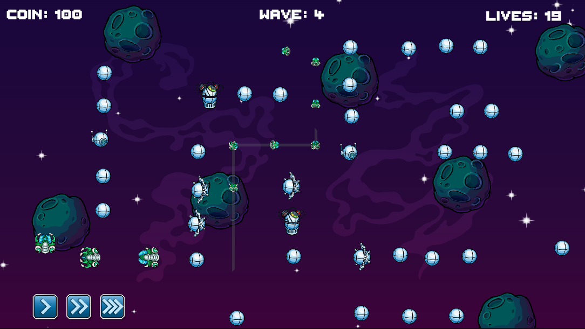
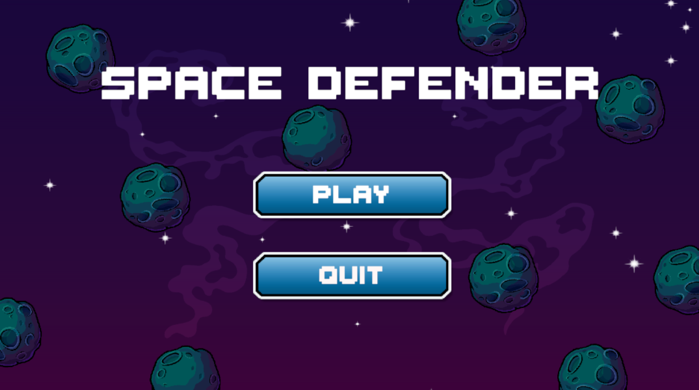
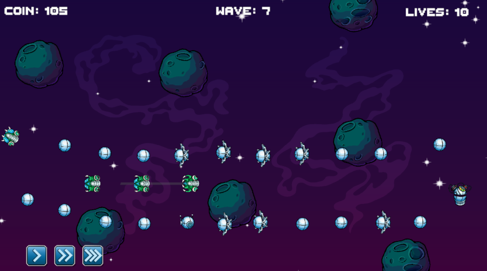
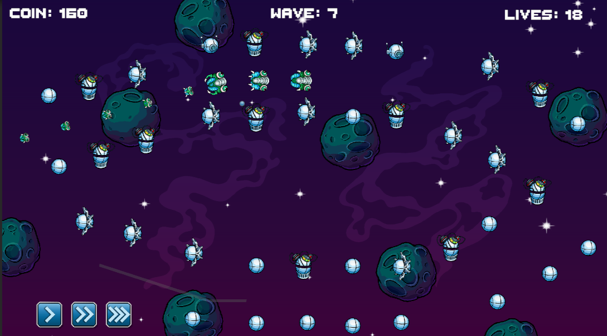
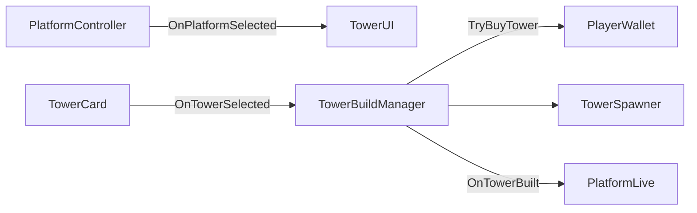

# Space Defender

**Space Defender** is a 2D Tower Defense game developed with **Unity** and **C#**. Players place towers on fixed platforms, manage coins, and choose the right defense to stop enemy waves from reaching the base. Enemies follow a path made of waypoints.

The game focuses on a simple gameplay loop that can be extended with data. Players win by completing all waves and must protect the base from losing all its health.

## Game Links

- **Play on itch.io:** [PLAY GAME](https://hoangdn1908.itch.io/space-defender)
- **Gameplay Video:** `ADD GAMEPLAY VIDEO LINK HERE`

## Gameplay Screenshots

| Main Menu | Level 2 | Level 3 |
|---|---|---|
|  |  |  |

## About the Game

Each level has several enemy waves with different enemies and spawn times. Enemies follow a fixed path. If they reach the end, they damage the base. When players defeat enemies, they earn coins. They can use these coins to build more towers and prepare for the next waves.

**Gameplay Loop**

1. Choose an empty platform on the map.
2. Buy a tower with the available coins.
3. The tower finds enemies in its range and fires projectiles automatically.
4. Earn coins from defeated enemies and improve the defense until all waves are completed or the base is destroyed.

## Gameplay Features

- Build towers on fixed platforms. The game checks if a platform is empty and if the player has enough coins.
- Towers find enemies within their range and attack based on their own fire rate and damage settings.
- Multiple enemy waves with different `SpawnGroup` settings, including enemy count, group delay, and spawn interval.
- Enemies follow waypoints, give coins when defeated, and damage the base when they reach the goal.
- UI displays base health, coins, and wave progress. The game also supports pause, win, lose, restart, and next-level features.
- Sound effects for UI actions and gameplay events, such as building towers, spawning enemies, shooting, pausing, winning, and losing.

## Technical Highlights

### 1. Data-Driven Gameplay with ScriptableObject

Game data is separated from gameplay logic. This allows me to change settings in the Unity Inspector without changing the main gameplay code.

- `EnemyData` stores enemy speed, health, damage, coin reward, sprite, and enemy type.
- `TowerData` stores tower cost, detection range, fire rate, projectile settings, and tower image.
- `PlayerData` stores starting health and coins. `GameModeData` contains wave data, while `TowerDatabase` provides tower data for the tower card UI.
- Each `WaveData` contains several `SpawnGroup` objects. `WaveController` reads this data with coroutines and spawns each group in order. It starts the next wave only when no enemies are active.

This system allows me to change enemy types, spawn times, and level difficulty through assets in `Assets/ScriptableObject/` without changing the main spawning logic.

### 2. Component-Based Architecture

Enemies, towers, and projectiles use separate components for different tasks instead of putting all behavior in one class.

- `EnemyController` prepares enemy data before spawning and works with `EnemyMovement`, `EnemyHealth`, `EnemyVisual`, and `EnemyLive`.
- `TowerController` works with `TowerDetect`, `TowerShoot`, and `TowerVisual` to find targets, control shooting, and update the tower's appearance using `TowerData`.
- `ProjectileController` works with `ProjectileShoot`, `ProjectileDamage`, `ProjectileSize`, and `ProjectileLive` to control movement, damage, size, and lifetime.

This structure keeps tasks such as movement, health, target detection, and object lifetime separate. It also makes the code easier to read and update when adding new enemy or tower types.

### 3. Event-Driven Communication

`GameEvents` is a central place for gameplay events, such as platform and tower selection, enemy spawning and death, base damage, coin and health changes, wave updates, and game results.

Systems send events through `Raise...` methods. The UI, player, and `GameManager` listen for these events in `OnEnable()` and stop listening in `OnDisable()`.

For example, building a tower follows this flow:

`TowerBuildManager` only creates a tower after checking that the platform is empty and `PlayerWallet.TryBuyTower()` succeeds. Using events means the UI does not need direct references to gameplay controllers.

### 4. Game State Machine

`GameManager` controls the `GameStateMachine`, which has four states: `PlayingState`, `PauseState`, `WinState`, and `LoseState`.

`GameStateMachine.ChangeState()` calls `Exit()` on the current state before calling `Enter()` on the new state.

- `PlayingState` allows the game to continue and hides the state UI.
- `PauseState`, `WinState`, and `LoseState` stop gameplay by setting `Time.timeScale = 0` and show the correct panel.
- `GameManager` changes states when it receives `OnGameWin` or `OnGameLose`, or when the player presses `Escape` during gameplay.

This system separates game state logic from the UI and helps prevent gameplay from continuing behind the pause, win, or lose screens.

### 5. Object Pooling for Enemies and Projectiles

`ObjectPool` stores pre-created prefabs in a `Queue<GameObject>`. When an object is needed, `EnemySpawner` or `TowerShoot` gets it by calling `GetFromPool()`. When an enemy is defeated or reaches the goal, or when a projectile reaches the end of its lifetime, the object is returned by calling `ReturnToPool()`.

`EnemyLive` and `ProjectileLive` control when objects are returned. `EnemySpawner` selects the correct pool based on `EnemyType`.

The pool can create more objects when the queue is empty. It also uses a `HashSet<GameObject>` to help prevent the same object from being returned more than once. This is useful for enemies and projectiles that are created and reused many times during a game.

## Controls

| Action | Function |
|---|---|
| Click an empty platform | Select a place to build a tower |
| Click a tower card | Buy and build a tower if there are enough coins |
| `Escape` | Pause the game during gameplay |
| Speed button | Change `Time.timeScale` |
| `Resume` / `Restart` / `Main Menu` | Continue, restart, or return to the main menu |
| `Next Level` | Go to the next level after winning |
